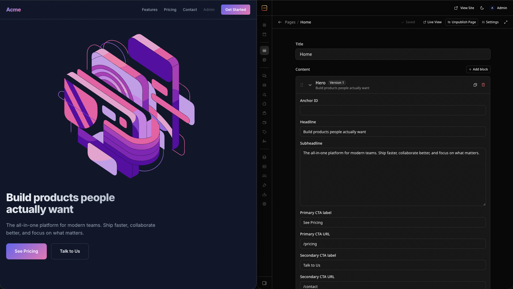

# EmDash Blueprint

A production-ready starter for content-managed marketing sites on
[EmDash](https://emdashcms.com), the Astro-native CMS, built to deploy on
[Rock8Cloud](https://rock8.cloud) in one push. Every page is assembled from
editable blocks in the EmDash admin; content lives in PostgreSQL, media on S3,
and the build is a single Bun server in a checked-in Dockerfile.

[](https://app.rock8.cloud/login?redirect=%2Fnew-deployment%3Fblueprint%3Demdash-blueprint%26utm_source%3Dgithub%26utm_medium%3Dreadme%26utm_campaign%3Dblueprint)



The landing page is for **Acme**, a fictional product — it exists to show what
the stack looks like out of the box. Replace the content in the admin.

| Layer   | Tech                                                                                                         |
| ------- | ------------------------------------------------------------------------------------------------------------ |
| CMS     | [EmDash](https://emdashcms.com) — admin UI at `/_emdash/admin`, passkey login, block editor                   |
| Site    | [Astro](https://astro.build), server-rendered via [`@astrojs/node`](https://docs.astro.build/en/guides/integrations-guide/node/) |
| Data    | [PostgreSQL](https://www.postgresql.org) 17 via [`pg`](https://node-postgres.com)                              |
| Media   | Local disk in development, S3-compatible storage in deployment (auto-switches on `S3_*`)                      |
| Tooling | [Bun](https://bun.sh) (package manager and production runtime), Docker Compose for local Postgres            |
| Deploy  | [Rock8Cloud](https://rock8.cloud) — one Dockerfile service + managed PostgreSQL + S3 storage                  |

## Quickstart

Prerequisites: [Bun](https://bun.sh) ≥ 1.3, [Node.js](https://nodejs.org) ≥ 22.16
(the Astro and EmDash CLIs run on it), Docker.

```sh
bun install
cp .env.example .env
bunx emdash secrets generate --write .env --force   # your own EMDASH_ENCRYPTION_KEY
docker compose up -d                                # start PostgreSQL
bun run dev                                         # http://localhost:4321
```

Open http://localhost:4321/_emdash/admin and complete the setup wizard: site
title, keep **sample content** enabled, your email, then register a passkey.
EmDash runs its migrations and applies `seed/seed.json`, so the landing page,
pricing and contact pages are populated immediately.

## Layout

```
src/
  pages/                     index, pricing, contact, 404 — all server-rendered
  components/
    blocks/                  one Astro component per marketing block
    MarketingBlocks.astro    maps stored blocks to components
  layouts/Base.astro         EmDash wiring: menus, search, page contributions
  styles/
    tokens.css               design tokens (defaults — don't edit)
    theme.css                token overrides — restyle here
  storage.mjs                media storage: S3 when S3_BUCKET is set, else ./uploads
  live.config.ts             EmDash loader registration (boilerplate)
seed/seed.json               schema + demo content, applied on first setup
db-env.mjs                   maps DATABASE_URL to the PG* vars pg reads at runtime
Dockerfile                   how Rock8Cloud builds this service
docker-compose.yml           local PostgreSQL (`app` profile adds the production image)
.mcp.json                    Rock8Cloud + EmDash docs MCP endpoints
.agents/skills/              EmDash agent skills (linked from .claude/skills)
AGENTS.md                    guidance for coding agents
```

## Content model

Everything visitors see is editable in the admin — there are no hardcoded
content pages.

| What                | Where in the admin       | Notes                                                              |
| ------------------- | ------------------------ | ------------------------------------------------------------------ |
| Home, Pricing, Contact | **Pages**             | `title` + `content`, a blocks field you add, reorder and edit       |
| Header & footer links | **Menus**              | `primary`, `footer_product`, `footer_company`, `footer_support`    |
| Site title, tagline | **Settings**             | Title is the logo wordmark; tagline is used in the footer and meta |
| Images              | **Media**                | Hero and testimonial avatars                                       |

Block types available in a page's `content` field:

| Block                    | Fields                                                                                     |
| ------------------------ | ------------------------------------------------------------------------------------------ |
| `marketing_hero`         | headline, subheadline, primary/secondary CTA label + URL, image, centered                  |
| `marketing_features`     | headline, subheadline, repeater of `{ icon, title, description }`                          |
| `marketing_testimonials` | headline, repeater of `{ quote, author, role, company, avatar }`                           |
| `marketing_pricing`      | headline, repeater of `{ name, price, period, description, features, cta_label, cta_url, highlighted }` |
| `marketing_faq`          | headline, repeater of `{ question, answer }`                                               |

Every block also has an `anchor_id` for in-page links. Edits are saved as
drafts; **Publish** makes them live immediately — the site is server-rendered,
so there is no rebuild.

## Commands

| Command                 | What it does                                               |
| ----------------------- | ---------------------------------------------------------- |
| `docker compose up -d`  | Start local PostgreSQL                                     |
| `bun run dev`           | Dev server with HMR on `:4321`                             |
| `bun run build`         | Production build → `dist/`                                 |
| `bun run start`         | Run the production build (`db-env.mjs` preloaded)          |
| `bun run typecheck`     | `astro check`                                              |
| `bun test`              | Unit tests                                                 |
| `bunx emdash types`     | Regenerate `emdash-env.d.ts` from the running site         |

## Deploy on [Rock8Cloud](https://rock8.cloud)

### Connect MCP and prompt your agent

This repository ships [`.mcp.json`](.mcp.json) with the Rock8Cloud MCP endpoint
already configured, so an MCP-capable coding agent can do the whole deployment.
Open the repo in your agent (Claude Code, for example), complete the OAuth login
when prompted, and ask:

```text
Deploy this project to Rock8Cloud.
```

No API key, deployment CLI or GitHub Actions workflow is required.

### Or deploy via the UI

1. **Push this repository to GitHub** and create a project at
   [app.rock8.cloud](https://app.rock8.cloud).
2. **Add a PostgreSQL service** (managed database, version 17).
3. **Add an S3 Object Storage service.** It can stay private: without
   `S3_PUBLIC_URL`, EmDash serves media through the app at
   `/_emdash/api/media/file/…`. The container disk is not persistent — without S3,
   uploads are lost on every redeploy.
4. **Add a service from the repository**: Dockerfile path `Dockerfile`, default
   build context (repository root), container port **4321**. Environment:
   - Link the PostgreSQL `URL` variable (libpq-compatible) to `DATABASE_URL`.
   - Link the storage's `S3_ENDPOINT`, `S3_BUCKET`, `S3_REGION`,
     `S3_ACCESS_KEY`, `S3_SECRET_KEY`, `S3_FORCE_PATH_STYLE` (names already match).
   - Set `EMDASH_ENCRYPTION_KEY` — generate it with
     `bunx emdash secrets generate` and keep a copy with your database backups.
   - Set `EMDASH_SITE_URL` to the service's public URL.
5. **Deploy**, then open `<your URL>/_emdash/admin` and run the setup wizard.
   Passkeys are bound to the domain, so register one on the deployed site.
6. Every push to `main` redeploys automatically. Migrations run on startup.

`PORT` is injected by the platform — do not set it manually; the Astro Node
server binds whatever it is given.

Verify the image locally before deploying:

```sh
docker compose --profile app up -d --build   # http://localhost:4321, against the compose Postgres
```

> The `EXPOSE`d port (4321) must match the port configured on the Rock8Cloud
> service, or health checks will fail.

## Environment variables

| Variable                | Required     | Purpose                                                                                      | Local default          |
| ----------------------- | ------------ | -------------------------------------------------------------------------------------------- | ---------------------- |
| `DATABASE_URL`          | yes          | PostgreSQL connection string. Read at runtime, never baked into the image                    | compose Postgres       |
| `EMDASH_ENCRYPTION_KEY` | yes          | Encrypts plugin secrets. Losing it loses those secrets                                       | generated              |
| `EMDASH_SITE_URL`       | in deployment | Public origin behind HTTPS — used for links, passkeys and SEO URLs                          | unset                  |
| `S3_ENDPOINT`, `S3_BUCKET`, `S3_REGION`, `S3_ACCESS_KEY`, `S3_SECRET_KEY`, `S3_FORCE_PATH_STYLE`, `S3_PUBLIC_URL` | in deployment | S3-compatible media storage; unset → `./uploads`. `S3_FORCE_PATH_STYLE=false` switches to `<bucket>.<host>` requests (Rock8Cloud's public endpoint needs it); `S3_PUBLIC_URL` is optional (CDN / public bucket); `S3_ACCESS_KEY_ID` / `S3_SECRET_ACCESS_KEY` also work | unset |
| `POSTGRES_PORT`, `APP_PORT` | no       | Host ports for `docker-compose.yml`                                                          | `5432`, `4321`         |

Managed Postgres URLs work as-is, including `?sslmode=require` and
Rock8Cloud's libpq-compatible `?sslmode=require&uselibpqcompat=true`
(encrypted, certificate not verified — as in libpq).

**Why `astro.config.mjs` passes `postgres({})`:** EmDash serializes its
`emdash()` config into the build output, so the documented
`postgres({ connectionString: process.env.DATABASE_URL })` would bake the
build-time password into `dist/` and ignore the runtime value. `db-env.mjs`
maps `DATABASE_URL` to the `PG*` variables `pg` reads when the server starts,
and `src/storage.mjs` does the same job for S3, so one image runs in every
environment.

## Extending the blueprint

### Edit content

Use the admin — pages, blocks, menus and settings are all content. Code changes
are only needed for new block types, new page templates or styling.

### Add a block type

1. Add the type to `blockTypes` in `seed/seed.json` and its slug to the
   `content` field's `validation.allowedTypes`.
2. Create `src/components/blocks/<Name>.astro` (props: `value`, `index`,
   `blockKey`) and register it in `src/components/MarketingBlocks.astro`.
3. The seed is applied only on first setup. Locally, reset with
   `docker compose down -v && docker compose up -d` and run the setup wizard
   again; for a deployed site, add the block type to the running schema too.

See the `building-emdash-site` skill in `.agents/skills/` and the
[block docs](https://docs.emdashcms.com/guides/blocks/).

### Restyle

Override design tokens in `src/styles/theme.css` — brand and accent colours
drive every gradient. Change the font in `astro.config.mjs` under `fonts`.
`AGENTS.md` lists the tokens worth knowing.

### Add a plugin

EmDash plugins add hooks, admin pages, API routes and block types. Register them
in `emdash({ plugins: [...] })` — see the `creating-plugins` skill and the
[plugin docs](https://docs.emdashcms.com/plugins/overview/).

## Learn more

- [EmDash documentation](https://docs.emdashcms.com) · [Astro documentation](https://docs.astro.build)
- [Rock8Cloud](https://rock8.cloud) · [Rock8Cloud docs](https://docs.rock8.cloud)

## License

MIT — use it however you like.
